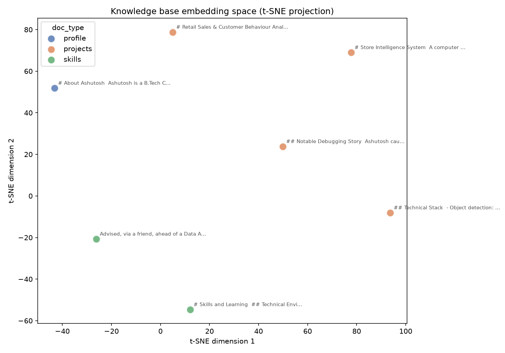
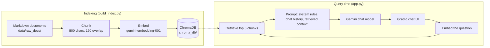

# AI Knowledge Worker

A retrieval-augmented generation (RAG) chatbot that answers questions about a set of
documents, grounded in what it retrieves, plus an evaluation harness that measures how
well it retrieves and answers, and a test suite.

Built with Python, ChromaDB, the Gemini API, Gradio and Pydantic. LangChain is used only for its
text splitter.



*t-SNE projection of the knowledge base's chunk embeddings, coloured by document category.*

## How it works



1. **Ingest.** Markdown files in `data/raw_docs/` are split into overlapping chunks. Each chunk is
   tagged with its folder name as a `doc_type` (profile, projects, skills) and embedded.
2. **Store.** Vectors, text and metadata are saved in a persistent ChromaDB collection.
3. **Retrieve.** The question is embedded and the 3 closest chunks are fetched.
4. **Generate.** The model gets a system prompt telling it to answer only from the context (or say it
   does not know), the conversation so far, and the retrieved chunks labelled with their source.

## Quick start

```bash
git clone https://github.com/TheQuietArc/ai-knowledge-worker-rag.git
cd ai-knowledge-worker-rag
python -m venv venv && source venv/bin/activate
pip install -r requirements.txt

cp .env.example .env        # then put your key in .env (free key: aistudio.google.com/apikey)
python build_index.py       # build the vector store
python app.py               # open the local URL it prints
```

The Gemini models are called through the OpenAI Python SDK pointed at Gemini's OpenAI-compatible
endpoint. Model names and chunk settings live in `rag/config.py`.

## Evaluation

Changing a setting such as chunk size is guesswork without a measurement, so the project includes a
harness in `eval/`.

- **Golden set:** 18 hand-written questions, each with the keywords a retrieved chunk must contain
  and a reference answer (`eval/golden_set.py`, validated with Pydantic).
- **Retrieval metrics:** MRR, nDCG@k and keyword coverage, implemented from scratch in
  `eval/metrics.py` and tested against hand-computed values.
- **Answer quality:** an LLM judge scores each answer 1 to 5 for accuracy, completeness and
  relevance against the reference answer, returning JSON that is validated before use.

```bash
python run_eval.py retrieval                                   # compare chunking settings (embeddings only)
python run_eval.py answers --tag baseline --only 1,6,7,10,14,18 # judge answers on chosen questions
```

### Retrieval results

Six configurations, changing one thing at a time (chunk size / overlap, and how many chunks are retrieved, k):

| Configuration | Chunks | MRR | nDCG@k | Keyword coverage | Fully answerable |
|---|---|---|---|---|---|
| 400/80, k=3 (original) | 14 | 0.741 | 0.754 | 0.917 | 16/18 |
| 200/40, k=3 | 34 | 0.625 | 0.634 | 0.917 | 16/18 |
| **800/160, k=3 (current)** | 7 | **0.833** | **0.860** | **1.000** | **18/18** |
| 400/0, k=3 | 14 | 0.769 | 0.786 | 0.972 | 17/18 |
| 400/80, k=1 | 14 | 0.583 | 0.583 | 0.583 | 10/18 |
| 400/80, k=5 | 14 | 0.762 | 0.787 | 1.000 | 18/18 |

The original setting missed required facts on two questions. In one, a fact was split across two
chunks; in the other, the relevant sentence sat in a section that ranked below the title chunk. Larger
chunks fixed both. The same table is saved in `eval/results_retrieval.md`.

### Answer quality

Judged on six questions: the two that retrieval had missed plus four controls (full run data in `eval/runs/`).

| | Accuracy | Completeness | Relevance |
|---|---|---|---|
| 400/80 chunks | 4.00 | 3.67 | 4.17 |
| 800/160 chunks | 5.00 | 4.83 | 5.00 |

The two previously failing questions went from 1/1/1 and 3/2/4 to 5/5/5, and the four controls did not change.

### How to read these numbers

- The test set is small (18 questions) and the knowledge base is tiny (7 chunks at the current setting,
  so retrieving 3 covers a large share of it). Treat big gaps as signal and small ones as noise.
- 800/160 was chosen after seeing the two failures, so confirming they now pass is expected. A set of
  new, held-out questions would be the proper test.
- The answer-quality subset was picked partly because of those failures, so its averages overstate overall
  quality. The judge is the same model family that writes the answers, and each run was done once.
- Relevance is judged by keyword presence, which is a proxy for "this chunk answers the question".

## Tests

```bash
pip install -r requirements-dev.txt
python -m pytest
```

63 tests cover the metrics, chunking, the golden set's validity, retry handling, the RAG chain's
request construction, the chat-history handling in the UI, and the resumable evaluation runner. None of
them call the real API.

## Project structure

```
rag/              config, ingestion (chunking), vectorstore (embed, ChromaDB, retry), chain (RAG pipeline)
eval/             golden_set, metrics, retrieval_eval, answer_eval; results_retrieval.md and runs/
scripts/          visualize_embeddings (t-SNE plot)
tests/            pytest suite
data/raw_docs/    sample knowledge base, one folder per doc_type
docs/             images used in this README
app.py            Gradio chat UI
build_index.py    builds the vector store
run_eval.py       runs the evaluations
```

## Engineering notes

- **Retries distinguish error types.** Rate limits (per minute), server overload and dropped connections are
  retried with growing waits. A per-day quota error fails immediately instead of retrying for minutes.
- **Evaluation runs are resumable.** Progress is saved after every answer, and the judge scores all answers in
  one call, which keeps a run within a free-tier daily request limit; a run that hits the limit resumes where it stopped.
- **Embeddings are cached on disk** during retrieval experiments, so reruns cost no API calls.
- **Chat UI works across Gradio versions** by normalising whichever history format it receives.

## Limitations

- **Follow-up questions are not rewritten.** Chat history reaches the model, but retrieval searches with the
  latest message only, so a vague follow-up such as "tell me more about it" can retrieve the wrong chunk.
- **History grows without a limit** and is sent on every turn.
- **Small sample data.** The knowledge base is a few short documents, so this demonstrates the pipeline and the
  measurement method rather than performance at scale.
- **Runs locally.** There is no deployment or API layer; the UI and pipeline run in one Python process.

## Possible next steps

Query rewriting for follow-ups (measurable with the existing harness), a metadata filter in the UI, a larger
corpus with a held-out question set, a different model family as judge, and a FastAPI endpoint with Docker packaging.
